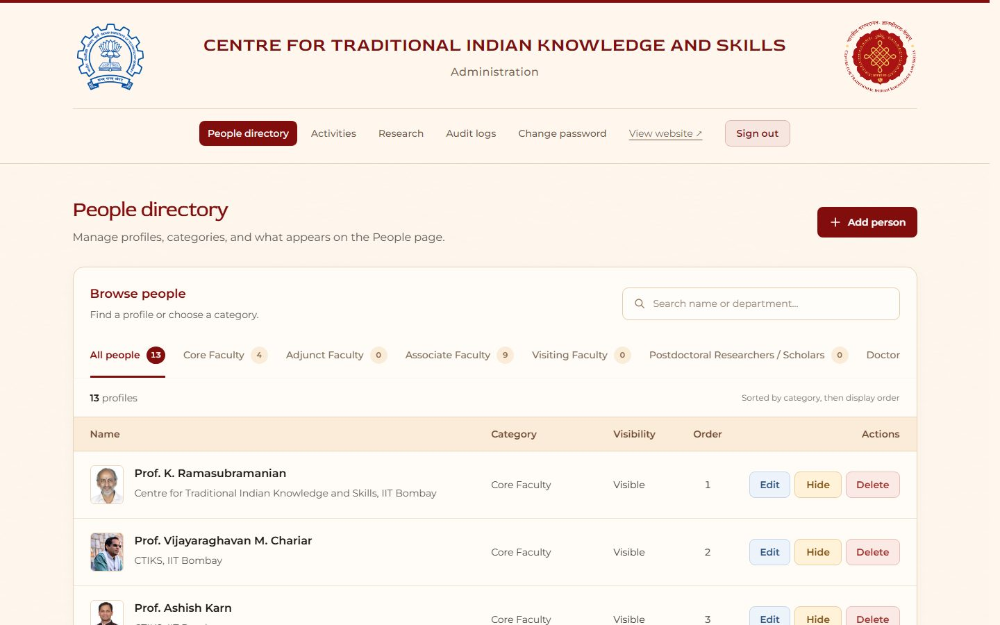

Read this if you want to run or work on the CTIKS website.

# CTIKS website

The website for the Centre for Traditional Indian Knowledge and Skills, IIT Bombay. It brings together the centre's people, research, academic programmes, and activities. Administrators manage website content, and core faculty can edit their own profiles.

## Screenshots

| Home                                                   | Research                                              |
| ------------------------------------------------------ | ----------------------------------------------------- |
|           |       |
| **Academics**                                          | **Administration**                                    |
|  |  |

Screenshots are from a local development copy. The admin page uses a local test account.

## Built with

- **Next.js, React and TypeScript** for the website and server.
- **PostgreSQL and Prisma** for storing and accessing data.
- **Better Auth** for sign-in, and **Redis** for sessions and request limits.
- **Tailwind CSS and CSS modules** for styling, and **Zod** for checking form data.
- **Playwright** and Node's test runner for automated checks.

## Run locally

Install Node.js, Git and Docker with Docker Compose. The [setup guide](docs/GETTING_STARTED.md) lists the supported Node versions and explains each step.

The commands below work in PowerShell, Git Bash, and Bash on macOS or Linux. Docker must be running.

```bash
git clone https://github.com/kushagr1501/CTIKS-IITB-UAT.git
cd CTIKS-IITB-UAT
npm ci
node scripts/setup-env.mjs
npm run redis:setup
npm run db:local:up
npm run db:generate
npm run db:migrate
npm run db:seed
npm run dev
```

Open [localhost:3000](http://127.0.0.1:3000). To open the admin panel, use `/login` and the local credentials created in `.private/admin-credentials.txt`. The setup script will not overwrite an existing `.env.local` file.

If a port is already in use, follow the [alternate-port instructions](docs/GETTING_STARTED.md#when-the-default-service-ports-are-busy).

## Find your way around

- [Project guide](docs/PROJECT_GUIDE.md) — pages, features and the folders behind them.
- [Getting started](docs/GETTING_STARTED.md) — setup and troubleshooting.
- [Testing](docs/TESTING.md) — checks and how to run them.
- [Contributing](docs/CONTRIBUTING.md) — making and reviewing changes.

Next: [open the project guide](docs/PROJECT_GUIDE.md) or [set up the site](docs/GETTING_STARTED.md).
