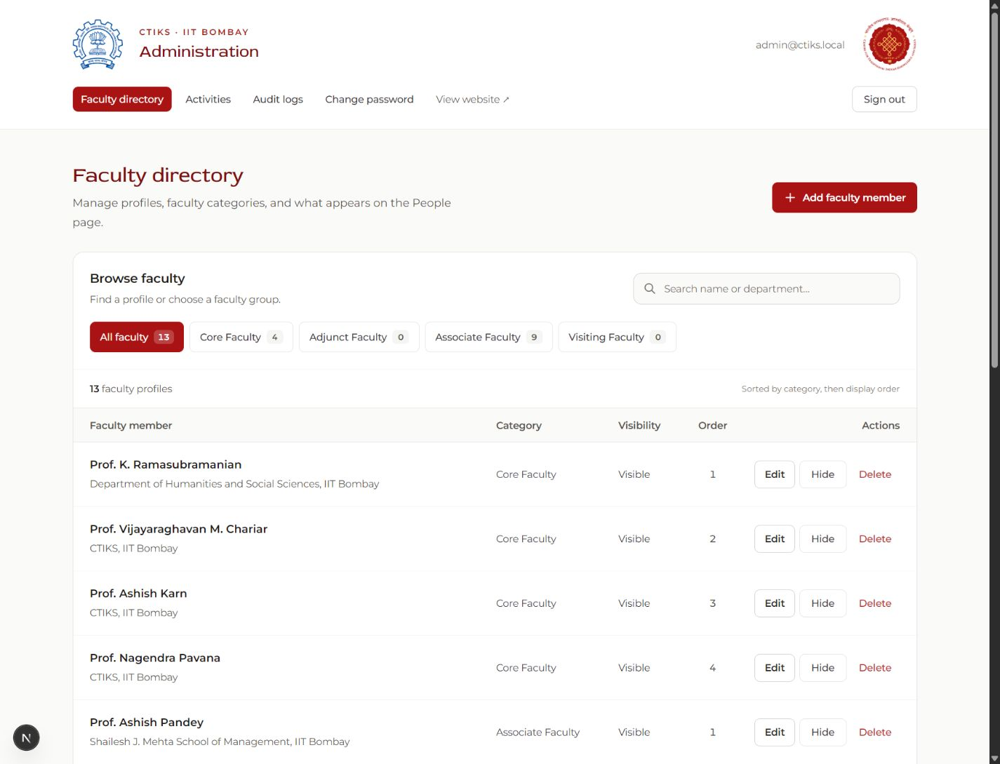
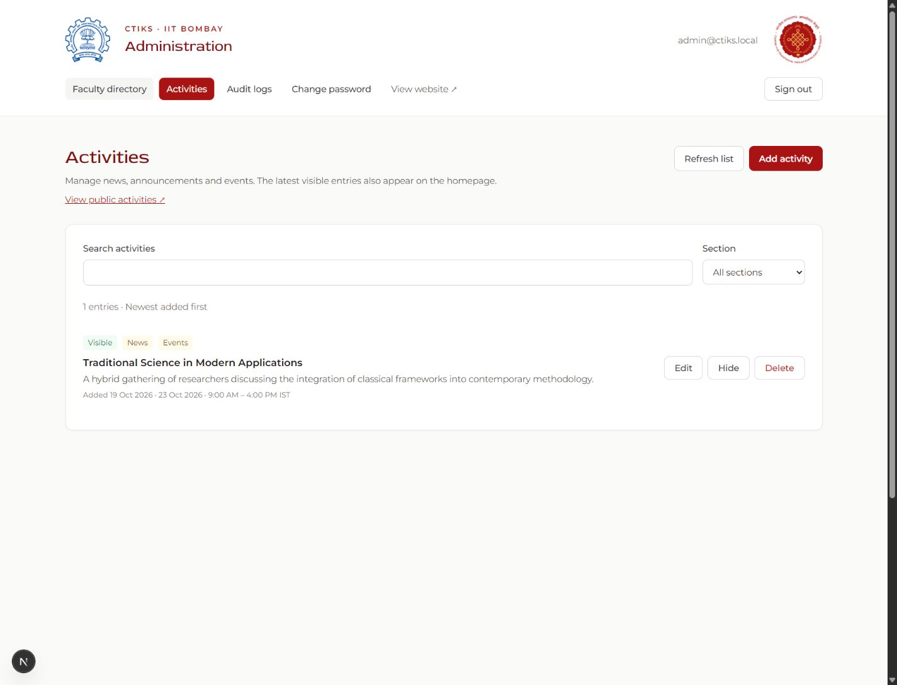
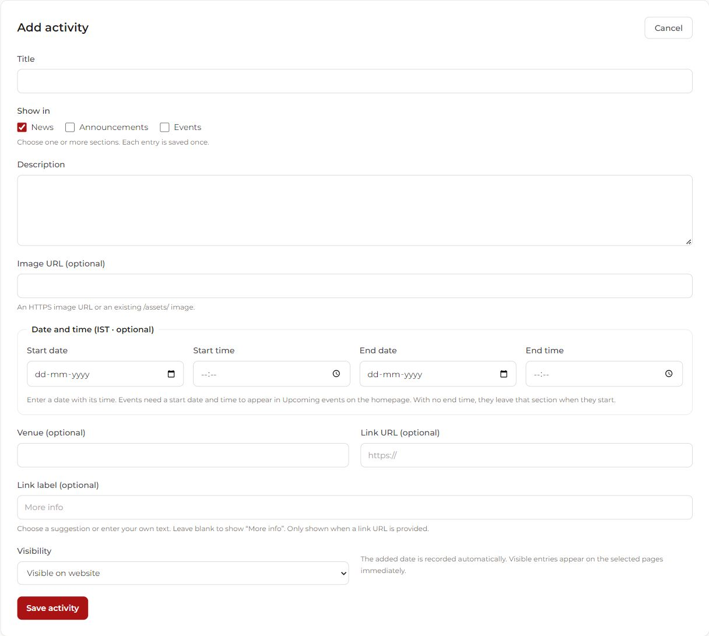

# CTIKS IIT Bombay — UAT

Website and administration portal for the Centre for Traditional Indian Knowledge
and Skills, IIT Bombay. Built with Next.js 16, React 19, TypeScript, Tailwind CSS,
Prisma/PostgreSQL, Better Auth, and Redis.

## Website snapshots

Captured from the local UAT site on 19 October 2026.

### Landing page

The public homepage with institute branding and the main introduction.


### Admin panel — faculty directory

Search and filter faculty profiles, manage visibility, and edit directory entries.



### Admin panel — Activities

Manage news, announcements, and events from one place.



<details>
<summary>Activity editor</summary>

Create an activity with categories, a description, optional dates and location,
and a custom link label.



</details>

## Local setup

Use Node.js 22.12+ and Docker Desktop (or an existing Redis service). Development
uses local PostgreSQL and Redis; UAT and production remain on Neon.

1. Run `npm ci` and copy `.env.example` to `.env.local`.
2. Run `npm run db:local:up` and `npm run redis:up`.
3. Run `npm run db:generate` and `npm run db:local:migrate`.
4. For a fresh local database, run `npm run db:local:seed`. This creates local
   administrator and sample faculty records; it never connects to Neon. Local
   admin credentials are written to `.private/local-admin-credentials.txt`.
5. Run `npm run redis:setup` if Redis credentials have not been created yet, or
   configure your own Redis URL.
6. For UAT or production, configure values from `.env.uat.example` in that
   deployment's environment. Keep `.env.migrations.local` local too; deployment
   migrations should use `DIRECT_URL` explicitly while the application uses the
   pooled `DATABASE_URL`.
7. For a fresh deployment, follow [backend setup](docs/backend.md) to seed the
   initial administrator/faculty records and provision the restricted database role.
8. Run `npm run dev` and open http://127.0.0.1:3000.

`npm run db:local:down` stops the local PostgreSQL container and preserves its
Docker volume. Do not use `docker compose down -v` unless you intend to delete
local database data.

Development generates the Prisma client when missing, after schema changes, or
after a Prisma version change. Production builds always regenerate it. Use
`.private/local-admin-credentials.txt` to sign in to the local database. A manual
`npm run db:seed` writes `.private/admin-credentials.txt` by default for the
database configured for that command; its password may differ from the local one.
Environment files, generated credential files, generated clients, build output, and temporary
previews are excluded from Git. Only the placeholder `.env.example` and
`.env.uat.example` templates belong in the repository.

### Development speed

`npm run dev` uses Turbopack with its persistent compilation cache and warms the
main public pages sequentially in the background. Wait for **Main pages ready**
when previewing the entire site. The first run after installing dependencies or
changing shared code still needs compilation. Database-backed pages continue to
read current data; the warm-up does not cache application records.

Keep `.next` between restarts to reuse the compiler cache. If a bundler-specific
issue occurs, `npm run dev:webpack` starts the Webpack fallback. Set
`CTIKS_DEV_WARMUP=0` to skip background warm-up. Port overrides such as
`npm run dev -- --port 3001` are supported; match `BETTER_AUTH_URL` to that origin
when testing account login locally.

The existing UAT administrator login is shared in [UAT admin access](docs/uat-admin-access.md)
at the repository owner's request. It applies to the existing UAT database.

## Project structure

- `src/app/` — public pages, administration/faculty portals, and API routes.
- `src/features/` — feature components, content, forms, and presentation helpers.
- `src/components/` — shared layout and UI components.
- `src/server/` — authentication, database access, validation, permissions, and auditing.
- `prisma/` — database schema and versioned migrations.
- `public/assets/` — local website images and design assets.
- `scripts/` — database/Redis setup and isolated integration checks.
- `tests/` — unit tests.
- `docs/` — architecture, backend operation, and Activities CMS documentation.

## Verification

```sh
npm run typecheck
npm run lint
npm test
npm run build
```

`npm run test:integration` additionally requires PostgreSQL migration-owner access
and Redis. It creates and removes a random test schema and Redis namespace; see
[backend setup](docs/backend.md). It does not seed activities into the application's
live schema.

For headless browser coverage, install the Chromium binary once with
`npx playwright install chromium`, then run `npm run test:browser`. It uses the same
isolated integration environment and exercises faculty CRUD in the admin UI and
draft/reload/research-area/publish flows in the professor portal.

## Production

Configure the deployment's environment and persistent services, apply migrations
with `npm run db:migrate`, then run `npm run build` and `npm start`. Hosting,
backups, HTTPS, and institute SMTP/storage provisioning are deployment concerns.
Pushing this repository does not deploy the site or copy database contents.

See [architecture](docs/architecture.md), [Activities CMS](docs/activities.md),
and the [faculty academic profile schema](docs/faculty-profiles.md).
