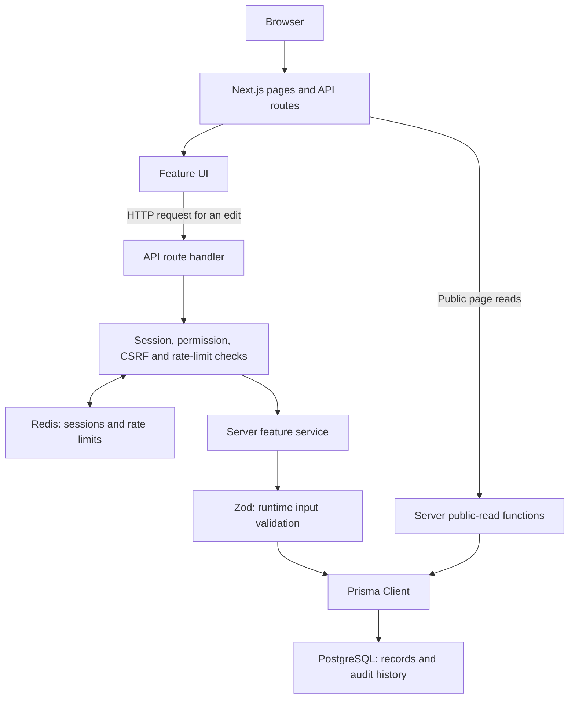

Read this if you want to understand how the browser, server, and database connect.

# Architecture

Next.js is the web framework. Its App Router maps files to web addresses called routes. React components
describe the user interface (UI). PostgreSQL stores records, Prisma provides the generated database code, and
Redis holds temporary sessions (login state) and request limits. [Glossary](GLOSSARY.md) defines these terms.

## Request flow

An API is the request contract between browser and server. Zod checks actual request data at runtime.
TypeScript checks code shapes before execution; it cannot replace this validation.

A public page can call a server read function directly. It does not need to send an HTTP request back into its
own API. Protected edits go through the API guard.

## One real edit, end to end

Example: an administrator edits a person's designation in People directory. A designation is the job title
shown on their profile.

1. `src/app/admin/people/page.tsx` checks page access and loads directory records. `FacultyManager.tsx` owns
   the list and opens `FacultyEditor.tsx`, the edit form.
2. The editor calls the manager's save callback. It submits the full editable record and its current
   `version`, a counter used to detect stale edits.
3. `src/features/admin/api-client.ts` fetches a CSRF token and sends the PATCH request to
   `/api/admin/faculty/{id}`. CSRF means cross-site request forgery; the token and Origin checks reject
   unwanted writes from other sites.
4. `src/app/api/admin/faculty/[id]/route.ts` delegates to `authorizedRequest` in
   `src/server/http/authorized-handler.ts`. The guard checks the current session, user role and permission,
   then the Redis-backed account request limit. A role is a group of permissions, such as `ADMIN` or
   `CORE_FACULTY`.
5. `updateFaculty` in `src/server/faculty/service.ts` validates the ID and input using
   `src/server/faculty/schema.ts`. Browser checks alone are not trusted.
6. Prisma runs a transaction: a set of database writes committed together. It updates the matching ID/version,
   increments the version, and writes an audit record. Failure rolls back the transaction so content and
   history stay together.
7. The route marks `/people` for revalidation and returns the updated record. Revalidation tells Next.js that
   page output may need to be regenerated.
8. The manager replaces the saved row in its state. Another request to the public directory reads records
   permitted by the visibility filter.

A stale version returns HTTP 409, a conflict response. Invalid input returns 400. `src/server/http/errors.ts`
produces the shared safe error shape. It avoids returning raw database errors or submitted secrets.

## Boundaries and decisions

| Boundary          | Decision and reason                                                                                                                     |
| ----------------- | --------------------------------------------------------------------------------------------------------------------------------------- |
| Pages and layouts | `src/app` arranges screens and handles addresses. Shared layouts wrap related pages.                                                    |
| Feature UI        | `src/features` groups forms and display logic by task. It does not open database connections from browser code.                         |
| Server services   | `src/server` owns validation, permissions, persistence, and auditing. `server-only` imports help keep this code out of browser bundles. |
| Database          | PostgreSQL keeps durable data. Prisma models live in `prisma/schema.prisma`; versioned SQL migrations preserve installation history.    |
| Sessions          | Redis stores temporary session data and limits. PostgreSQL keeps users and password hashes. Losing Redis can require signing in again.  |
| Client code       | A `'use client'` file starts a boundary for browser state/events. Keep that boundary narrow to avoid sending server code to browsers.   |
| Imports           | Use concrete file imports. Existing docs discourage new barrel files, which re-export a whole directory and can obscure dependencies.   |

The root layout adds global styles and the shared footer. `(public)` is a route group: its name organizes
files but is not part of the URL. Its layout adds the header, navigation, font switcher, and smooth scrolling.
Admin and faculty layouts supply their own protected navigation. Login is outside those protected layouts.

## Current behavior, not future promises

- People, Research, Activities, and homepage activity panels read database content. Academics and several
  other public sections still use checked-in content files.
- Core faculty have their own editor, drafts, autosave, and immediate publishing. Public visibility remains
  controlled by the administrator. See [faculty profiles](faculty-profiles.md).
- Every protected request checks access before it reads or changes private content.
- Uploaded media routes require development mode and a local database. Persistent production storage needs a
  separate integration. URL-based assets remain supported.
- This is a Node.js application with a database and Redis, not a static HTML export. A production package and
  the actual IITB server still need deployment verification.

## Safe extension points

Add a public section through a page in `src/app/(public)` and a matching feature folder. Use existing UI
patterns. Add a protected edit through a route, an existing permission guard, a Zod schema, and a server
service. Any new persisted field needs review of the Prisma model, migration, API, UI, and tests together.

Read the installed guide under `node_modules/next/dist/docs` before changing Next.js conventions. The
installed version is the source of truth for this repo.

Next: [Codebase map](CODEBASE_MAP.md), [Contributing](CONTRIBUTING.md), and [Testing](TESTING.md).
